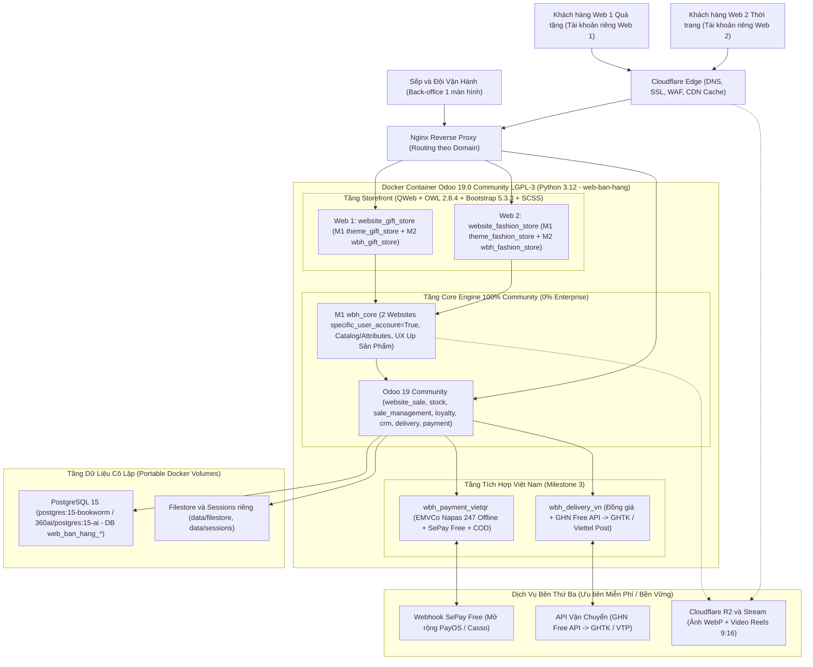

# ARCH — Kiến Trúc Kỹ Thuật Hệ Sinh Thái 2 Website Bán Hàng (Thuần Odoo 19.0 Community)

> **Phiên bản tài liệu**: v1.1 (Cập nhật theo 5 quyết định chốt & lộ trình Catalog-First)  
> **Ngày tạo**: 2026-11-25 | **Cập nhật lần cuối**: 2026-11-25  
> **Kiến trúc**: Single-Core Multi-Website — **100% Odoo 19.0 Community (LGPL-3)** + **PostgreSQL 15**  
> **Chuẩn áp dụng**: AIaC 3.0 & Plugin `360-odoo` / `360-local-builder-env`  
> **Tài liệu liên quan**: [IDEA.md](file:///F:/BACKUP_LINUX/web_ban_hang/docs/IDEA.md) | [REQUIREMENTS.md](file:///F:/BACKUP_LINUX/web_ban_hang/docs/REQUIREMENTS.md) | [CONTEXT.md](file:///F:/BACKUP_LINUX/web_ban_hang/docs/CONTEXT.md) | [SPEC.md](file:///F:/BACKUP_LINUX/web_ban_hang/docs/SPEC.md) | [DEPLOY_GUIDE.md](file:///F:/BACKUP_LINUX/web_ban_hang/docs/DEPLOY_GUIDE.md)

---

## 1. Tổng Quan Kiến Trúc (Architecture Overview)

Hệ thống được thiết kế theo mô hình **Thuần Odoo Multi-Website (Single Core Engine + 2 Storefronts độc lập)** trên nền **100% Odoo 19.0 Community (LGPL-3)** và **PostgreSQL 15**:

- **100% Odoo 19.0 Community (Miễn phí bản quyền vĩnh viễn)**: Toàn bộ 7 custom modules tuyệt đối **không** khai báo `depends` vào bất kỳ module Enterprise (`*_enterprise`, `account_accountant`, `crm_enterprise`, `mail_enterprise`...) nào. Nhờ đó hệ thống chạy sạch trên Odoo Community chính chủ và vẫn tương thích 100% nếu sau này có nhu cầu triển khai trên môi trường Enterprise.
- **1 Core Backend duy nhất + Tách thương hiệu ở tầng Khách hàng**:
  - Đội vận hành quản trị tập trung danh mục, biến thể, tồn kho SKU, đơn hàng, thanh toán và vận chuyển trên 1 trang Back-office.
  - Về phía khách hàng, **2 Storefronts tách riêng hoàn toàn thương hiệu, tài khoản đăng nhập (`specific_user_account=True`) và chương trình tích điểm Loyalty (`website_id`)**:
    - **Web 1 — Cửa hàng Quà tặng** (`website_gift_store` — Móc khóa, Gấu bông, Blind Box): `theme_gift_store` + `wbh_gift_store`.
    - **Web 2 — Cửa hàng Thời trang Quần áo** (`website_fashion_store`): `theme_fashion_store` + `wbh_fashion_store`.
- **Chiến lược Triển khai Catalog-First (3 Milestone)**:
  - **Milestone 1 (Ưu tiên làm ngay)**: Docker di động + `wbh_core` + `theme_gift_store` + `theme_fashion_store` ➜ Sếp đăng nhập upload sản phẩm ngay và xem live 2 giao diện.
  - **Milestone 2**: `wbh_gift_store` + `wbh_fashion_store` (nghiệp vụ đặc thù 2 ngành hàng).
  - **Milestone 3**: `wbh_payment_vietqr` + `wbh_delivery_vn` + Loyalty tách thương hiệu & Flash Sale.

### Bảng Tóm Tắt Công Nghệ & Phiên Bản (Tech Stack Summary)

| Lớp Kiến Trúc | Công Nghệ | Phiên Bản Chuẩn | Nguồn Xác Minh / Ghi Chú |
|---|---|---|---|
| **Frontend Template & UI** | Odoo QWeb SSR + OWL + Bootstrap + SCSS | **OWL `2.8.4`**, **Bootstrap `5.3.3`** | Xác minh trực tiếp từ `F:\BACKUP_LINUX\save\dev_env\19.0\origin\addons\web\static\lib\` |
| **Custom Themes** | Odoo Website Builder Themes (Upgrade-Safe) | `theme_gift_store`, `theme_fashion_store` | 2 module theme độc lập tại `F:\BACKUP_LINUX\web_ban_hang\addons\` |
| **Backend Application** | **Odoo 19.0 Community (LGPL-3)** | **Odoo `19.0`**, **Python `3.12`** | Official Docker image `odoo:19.0` (0% Enterprise dependency) |
| **Database** | **PostgreSQL 15** | **PostgreSQL `15`** (`postgres:15-bookworm`) | Mặc định `postgres:15-bookworm` di động; tùy chọn `360ai/postgres:15-ai` khi bật `pgvector` |
| **Thanh toán VN** | VietQR EMVCo / Napas 247 + Webhook | `wbh_payment_vietqr` (M3) | Tự sinh QR offline miễn phí 100% + Adapter mặc định **SePay Free** (mở rộng PayOS/Casso) |
| **Vận chuyển VN** | Nội bộ/Đồng giá + Carrier API | `wbh_delivery_vn` (M3) | Ưu tiên **GHN** (API miễn phí, có Sandbox) ➜ mở rộng **GHTK & Viettel Post** |
| **Media & Video CDN** | Cloudflare R2 (S3 API) + Cloudflare Stream/CDN | `boto3>=1.26.0`, `botocore>=1.29.0` | Offload ảnh nặng & video dọc 9:16 khỏi Filestore local (M2/M3) |
| **Container & Portability** | Docker Compose di động 100% trong Git repo | `docker-compose.yml` + `.env.example` | Chạy tạm Windows (ổ `F:\`) ➜ chuyển Local Server chỉ cần `git pull` + `docker compose up -d` |

---

## 2. Sơ Đồ Kiến Trúc Tổng Thể (System Architecture Diagram)

---

## 3. Kiến Trúc Frontend (Odoo 19.0 Website Storefronts)

### 3.1. Công nghệ & Phiên bản Frontend
Toàn bộ lớp giao diện được xây dựng thuần theo kiến trúc chuẩn của **Odoo 19.0 Website Community**:
- **QWeb Server-Side Rendering (SSR)**: Render HTML đầy đủ từ phía server cho toàn bộ trang chủ, danh mục, chi tiết sản phẩm — tối ưu trực tiếp SEO Google và tốc độ tải đầu (FCP/LCP) trên mạng 4G di động.
- **OWL Framework `2.8.4`** *(xác minh tại `F:\BACKUP_LINUX\save\dev_env\19.0\origin\addons\web\static\lib\owl\owl.js`)*: Tương tác mượt không reload trang (lọc thuộc tính, chọn biến thể màu/size, widget M2 gói quà/gợi ý size/Shop The Look, polling VietQR M3).
- **Bootstrap `5.3.3` & SCSS** *(xác minh tại `F:\BACKUP_LINUX\save\dev_env\19.0\origin\addons\web\static\lib\bootstrap\scss\mixins\_banner.scss`)*: Hệ lưới responsive ưu tiên Mobile-First.

### 3.2. Quy chuẩn Website Theme Upgrade-Safe (Chuẩn `360-odoo` cho Odoo 19.0)
Cả 2 theme module (`theme_gift_store` và `theme_fashion_store`) **BẮT BUỘC** tuân thủ nghiêm ngặt:
1. **Wrapper chuẩn Website Builder**: Mọi `website.page` bắt buộc bọc trong `
`.
2. **Snippet kéo-thả chuẩn**: Mọi building block bắt buộc có class `o_colored_level` và thuộc tính `data-snippet`.
3. **Tắt view core an toàn**: Dùng `data/presets.xml` với `active="False"` thay vì sửa trực tiếp hoặc xóa view core.
4. **Hệ màu SCSS động**: Khai báo bảng màu thương hiệu qua `$o-color-1..5` trong `static/src/scss/primary_variables.scss`.
5. **Asset Bundles chuẩn Odoo 19.0**: Chỉ đăng ký vào `web._assets_primary_variables`, `web.assets_frontend`, `web_editor.assets_wysiwyg`, `web.assets_backend`.

### 3.3. Thiết kế 2 Custom Theme Modules Độc Lập (Theo Lộ trình M1 ➜ M2)

| Tiêu chí | `theme_gift_store` (Web 1 — Quà tặng) | `theme_fashion_store` (Web 2 — Thời trang) |
|---|---|---|
| **Phong cách UI/UX** | Ấm áp, sinh động, thân thiện Gen Z (tone pastel/san hô), nhấn mạnh cảm xúc tặng quà. | Tối giản, editorial kiểu Lookbook hiện đại (đen/trắng/be cát), tỷ lệ ảnh dọc `3:4`. |
| **Phạm vi Milestone 1 (Catalog-First)** | Trang chủ snippet dịp lễ, Header/Footer riêng Web 1, Trang Shop có lọc Màu/Kích thước gấu/Dịp/Blind Box, trang chi tiết tối ưu mobile + extension slots cho M2. | Trang chủ Lookbook hero, Header/Footer riêng Web 2, Trang Shop có Color Swatch + lọc Size/Form/Chất liệu, trang chi tiết nút Size pills 1 tay + extension slots cho M2. |
| **Mở rộng Milestone 2** | Gắn vào slot có sẵn: Widget Hộp quà + Ruy-băng + Lời chúc thiệp, Form khắc/thêu tên, Bảng so sánh kích thước vật mẫu. | Gắn vào slot có sẵn: OWL Gợi ý Size thông minh, Shop The Look thêm trọn bộ 1 click, Video người mẫu dọc 9:16 từ CDN. |

### 3.4. Giải pháp Media & Video CDN
- **Milestone 1**: Sử dụng trực tiếp cơ chế nén WebP + lazy-loading sẵn có của Odoo 19.0 Community trên Filestore riêng (`data/filestore`) để Sếp up ảnh sản phẩm nhanh mà không cần cấu hình CDN ngay từ ngày đầu.
- **Milestone 2 & 3**:
  - Tích hợp **Cloudflare R2** (S3 API qua `boto3`, miễn phí egress) để offload kho ảnh dung lượng lớn.
  - Video ngắn người mẫu dọc 9:16 (Web 2) phát qua **Cloudflare Stream** (HLS adaptive bitrate) hoặc **Cloudflare R2 + Custom Domain CDN**; Odoo chỉ lưu URL stream và ảnh poster để không làm nghẽn worker HTTP.

---

## 4. Kiến Trúc Backend (100% Odoo 19.0 Community & 7 Custom Modules)

### 4.1. Luật Cứng 100% Odoo 19.0 Community (LGPL-3) & Quy chuẩn `360-odoo`
1. **0% Enterprise Dependency**: Cấm tuyệt đối đưa bất kỳ module nào thuộc bản Enterprise (`web_enterprise`, `account_accountant`, `crm_enterprise`, `mail_enterprise`, `social_*` Enterprise, v.v.) vào danh sách `depends` của 7 custom modules.
2. **XML Views chuẩn 19.0**: Cấm `attrs=` và `states=`; dùng biểu thức trực tiếp `invisible="..."`, `readonly="..."`, `required="..."`; bắt buộc dùng `<list>` thay cho `<tree>`.
3. **Python ORM chuẩn 19.0 (`Python 3.12`)**:
   - Bắt buộc `@api.model_create_multi` khi override `create()`.
   - Dùng `odoo.fields.Command` thay tuple x2many `(0, 0, ...)`.
   - Dùng `models.Constraint()` và `models.Index()` thay `_sql_constraints` / `index=True`.
   - Tôn trọng `allowed_company_ids`, toán tử `any!` / `not any!`, bọc HTML trong `message_post()` bằng `markupsafe.Markup(...)`.
4. **Changelog chuẩn trong `__manifest__.py`**: Ghi rõ `v19.0.x.y.z (YYYY-MM-DD)` + tag `[NEW]`, `[FIX]`, `[IMPROVE]`, `[SECURITY]`, `[REFACTOR]`, `[MIGRATE]`.

### 4.2. Các Odoo 19.0 Community Modules Tái Sử Dụng Trực Tiếp
Toàn bộ danh sách sau đều là module chuẩn thuộc bản **Odoo 19.0 Community (LGPL-3)** có sẵn ngay trong image `odoo:19.0`:
- **Nền tảng & Website**: `base`, `contacts`, `portal`, `product`, `website`, `website_sale`, `website_sale_wishlist`, `website_sale_comparison`, `website_sale_stock`, `theme_default`.
- **Bán hàng & Kho**: `sale_management`, `stock`.
- **Khuyến mãi, CRM, Thanh toán & Vận chuyển (kích hoạt từ M1/M3)**: `website_sale_loyalty`, `loyalty`, `crm`, `delivery`, `payment`, `payment_custom`.

### 4.3. Bản Thiết Kế 7 Custom Modules Theo Lộ Trình 3 Milestone (`F:\BACKUP_LINUX\web_ban_hang\addons\`)

| Milestone | # | Tên Module | Phụ thuộc (`depends` — 100% Community) | Trách nhiệm Cốt lõi |
|---|---|---|---|---|
| **M1** *(Làm ngay)* | 1 | `wbh_core` | `base`, `website`, `website_sale`, `website_sale_wishlist`, `website_sale_comparison`, `website_sale_stock`, `sale_management`, `stock`, `product`, `contacts`, `portal` | Khởi tạo 2 Website (`website_gift_store`, `website_fashion_store` với `specific_user_account=True`), danh mục mẫu, 7 thuộc tính biến thể chuẩn, mở rộng `product.template` (`wbh_store_scope`, `wbh_short_highlight`, `wbh_care_note`, `wbh_low_stock_threshold`), menu & form backend tối ưu up sản phẩm nhanh. |
| **M1** *(Làm ngay)* | 2 | `theme_gift_store` | `wbh_core`, `theme_default` | Theme Website Builder Upgrade-Safe cho Web 1 (Quà tặng): bảng màu `$o-color-1..5`, `data/presets.xml`, trang chủ + snippets dịp lễ, bộ lọc thuộc tính/màu, trang sản phẩm mobile-first + extension slots cho M2/M3. |
| **M1** *(Làm ngay)* | 3 | `theme_fashion_store` | `wbh_core`, `theme_default` | Theme Website Builder Upgrade-Safe cho Web 2 (Thời trang): bảng màu tối giản editorial, `data/presets.xml`, trang chủ Lookbook, bộ lọc Color Swatch/Size/Form/Chất liệu, trang sản phẩm mobile-first + extension slots cho M2/M3. |
| **M2** *(Làm sau)* | 4 | `wbh_gift_store` | `wbh_core` | Nghiệp vụ Web 1: Gói quà + thiệp viết tay (phụ phí & ngưỡng miễn phí), cá nhân hóa khắc/thêu tên, so sánh kích thước cạnh vật mẫu, combo quà tặng theo dịp & ngân sách, quản lý chi tiết Blind Box. |
| **M2** *(Làm sau)* | 5 | `wbh_fashion_store` | `wbh_core` | Nghiệp vụ Web 2: Bảng size & OWL Gợi ý Size thông minh (Chiều cao/Cân nặng/Form), Shop The Look thêm trọn bộ 1 click, quản lý Video dọc 9:16 từ CDN, luồng yêu cầu đổi size trên Portal (`wbh.size.exchange.request`). |
| **M3** *(Làm sau tiếp)* | 6 | `wbh_payment_vietqr` | `payment`, `website_sale`, `wbh_core` | Cổng thanh toán chuẩn `payment.provider`: Tự sinh mã **VietQR EMVCo / Napas 247** offline (miễn phí 100%, mọi ngân hàng VN) + Adapter Webhook mặc định **SePay Free** (mở interface cho PayOS/Casso) có xác thực chữ ký & idempotency + mở rộng quy tắc cọc COD đơn cá nhân hóa. |
| **M3** *(Làm sau tiếp)* | 7 | `wbh_delivery_vn` | `delivery`, `stock`, `website_sale`, `wbh_core` | Tích hợp `delivery.carrier`: Địa giới hành chính VN 3 cấp, Ship nội bộ/Đồng giá + ưu tiên adapter **GHN** (API miễn phí 100%, có Sandbox), mở rộng **GHTK & Viettel Post** (tính phí ship, đẩy vận đơn từ `stock.picking`, đồng bộ tracking). |

### 4.4. Chiến lược Tách Tài Khoản & Loyalty Theo Thương Hiệu
- **Tách tài khoản khách hàng**: Cả `website_gift_store` và `website_fashion_store` đều đặt cố định `specific_user_account = True` (tính năng chuẩn có sẵn của Odoo 19.0 Community). Khách hàng đăng ký bằng cùng 1 email/SĐT ở Web 1 sẽ hoàn toàn độc lập với Web 2, đảm bảo trải nghiệm thương hiệu riêng biệt.
- **Tách chương trình Loyalty (M3)**: Mọi bản ghi `loyalty.program` (tích điểm, hạng thành viên, voucher) bắt buộc gán `website_id` đích danh (`website_gift_store` hoặc `website_fashion_store`), đảm bảo điểm thưởng không bị lẫn chéo giữa 2 thương hiệu.
- **Kho hàng chung chống âm kho**: Tồn kho quản lý tập trung theo từng SKU/biến thể trên `stock.quant`, trừ kho realtime qua `website_sale_stock` và row-level lock PostgreSQL để ngăn overselling.

---

## 5. Kiến Trúc Cơ Sở Dữ Liệu (PostgreSQL 15)

### 5.1. Phiên bản Chọn dùng & Lý do Không dùng MySQL / MongoDB
- **Hệ quản trị CSDL chốt dùng**: **PostgreSQL 15**.
  - **Mặc định di động (Milestone 1)**: Image chính chủ **`postgres:15-bookworm`** để chạy ngay tức thì trên mọi máy (Windows / Local Server) mà không cần build image custom trước.
  - **Tùy chọn AI nâng cao (Milestone 3+)**: Có thể chuyển `POSTGRES_IMAGE=360ai/postgres:15-ai` (xây dựng từ `postgres:15-bookworm` + extension `postgresql-15-pgvector`) qua 1 dòng trong `.env` nếu bật tìm kiếm ngữ nghĩa/gợi ý sản phẩm bằng AI.
- **Lý do bắt buộc dùng PostgreSQL 15 & loại trừ MySQL / MongoDB**:
  1. **Kiến trúc bắt buộc của Odoo**: Odoo ORM chỉ hỗ trợ PostgreSQL (`psycopg2`), không hỗ trợ MySQL hay MongoDB.
  2. **Tính năng lõi**: Transactional DDL giúp cài/nâng cấp module an toàn; cột `JSONB` (Odoo 19 lưu bản dịch và properties trực tiếp trên JSONB); `pg_trgm` tìm kiếm tiếng Việt không dấu/mờ; MVCC + ACID bảo vệ tuyệt đối tồn kho và đối soát thanh toán VietQR.

### 5.2. Chiến lược Tách biệt Database & Filestore
- **Database riêng hoàn toàn**: `web_ban_hang_dev` (local), `web_ban_hang_staging` (Local Server), `web_ban_hang_prod` (Production). Khóa `DB_FILTER=^web_ban_hang.*$` và đặt `list_db = False` trên Staging/Production.
- **Docker Volume & Filestore riêng**: Named volume `web_ban_hang_pgdata` tách hẳn khỏi `odoo19-db`; thư mục `./data/filestore` và `./data/sessions` nằm độc lập, không chạm tới `F:\BACKUP_LINUX\save\dev_env\19.0\data\filestore\demo-19`.

### 5.3. Chiến lược Sao lưu (Backup) & Tối ưu Hiệu năng
- **Backup 3-2-1 & Di chuyển máy**: `pg_dump -Fc` định kỳ hàng ngày + nén thư mục `data/filestore`, đẩy bản mã hóa sang lưu trữ ngoài (Cloudflare R2). Chính cơ chế backup/restore này cũng được dùng để chuyển mượt dữ liệu sản phẩm Sếp đã up từ máy Windows sang Local Server ở nhà (xem [DEPLOY_GUIDE.md](file:///F:/BACKUP_LINUX/web_ban_hang/docs/DEPLOY_GUIDE.md)).
- **Tuning PostgreSQL 15 & Odoo**: `shared_buffers = 25% RAM`, `effective_cache_size = 70% RAM`, `work_mem = 16MB–32MB`, lập chỉ mục bằng `models.Index()` cho `wbh_store_scope`, `website_id`, mã giao dịch VietQR và bộ lọc thời trang; cấu hình `workers`, `db_maxconn` và dự phòng PgBouncer trên Production.

---

## 6. Hạ Tầng Docker Di Động (Windows ➜ Local Server) & Phân Tích Máy Sếp

### 6.1. Hiện trạng Thực tế trên Máy Windows Sếp (Đã xác minh 2026-11-25)
- **Windows Host**: Chưa cài Odoo native, chưa cài PostgreSQL native, chưa cài Docker Desktop (`docker not found`), các port `5432`, `8069`, `8070`, `8072`, `8079`, `8080`, `1900` đều trống. Có sẵn `Python 3.12.10` (`C:\Users\ADMIN\AppData\Local\Programs\Python\Python312\python.exe`), `Git`, `Node.js`.
- **WSL2**: Entry `VCloudOdoo19` bị hỏng do thư mục đích `F:\BACKUP_LINUX\local_odoo19\wsl_distro` không còn tồn tại (cần dọn bằng `wsl --unregister VCloudOdoo19`).
- **Ổ đĩa**: `C:\` còn `24.77 GB`; **`F:\` còn `227.22 GB`** (bắt buộc chuyển Docker Desktop WSL2 disk image sang ổ `F:\`); ổ mạng `Z:\` (`\\100.64.56.52\DATA`) đang `Disconnected`.
- **AIaC Root**: Hoạt động thực tế tại `F:\BACKUP_LINUX\aiac` (qua symlink `C:\Users\ADMIN\.claude\360org -> F:\BACKUP_LINUX\aiac\360org`).
- **Kho Odoo sẵn có tại `F:\BACKUP_LINUX\save\dev_env\`**: Có 3 bản `19.0` (1.474 modules gồm Community + Enterprise `OEEL-1`, `demo-19`), `17.0` và `15.0`, cùng các dự án độc lập `F:\DEV\v_mobile`, `F:\BACKUP_LINUX\zalo_socal`, và dump `F:\BACKUP_LINUX\save\backup\vuahethong\vuahethong_v19_prod_test.dump` (KHÔNG dùng).

### 6.2. Chiến lược Đóng Gói Docker Di Động & Tái Sử Dụng An Toàn

| Hạng mục | Quyết định | Đường dẫn / Cấu hình Áp dụng | Lý do & Bảo vệ Hệ thống |
|---|---|---|---|
| **Stack Docker Di động (M1)** | **ĐÓNG GÓI ĐỘC LẬP TRONG GIT** | `F:\BACKUP_LINUX\web_ban_hang\docker-compose.yml`, `config\odoo.conf`, `.env.example` | Dùng image chính chủ `odoo:19.0` (Community) + `postgres:15-bookworm`. Chạy tạm trên Windows (ổ `F:\`), khi Local Server ở nhà bật lại chỉ cần `git pull` + chỉnh `.env` + `docker compose up -d`. Không hardcode đường dẫn Linux `/media/tanma/...`. |
| **Tham khảo `dev_env\19.0\`** | **TÁI SỬ DỤNG CÓ CHỌN LỌC (Read-Only)** | `F:\BACKUP_LINUX\save\dev_env\19.0\origin\addons\` & `config\odoo.conf` | Chỉ dùng để tham khảo mã nguồn Community khi lập trình (hoặc tham khảo mẫu `odoo.conf` / Dockerfile cài `boto3`). **CẤM** nạp hoặc phụ thuộc các module `*_enterprise`. |
| **Module Zalo OA** | **TIỀM NĂNG (M3+)** | `F:\BACKUP_LINUX\zalo_socal` (`v19.0.1.12.4`) | Tham khảo tích hợp CSKH Zalo OA về sau (cần kiểm tra 0% phụ thuộc Enterprise trước khi ghép). |
| **Database, Volume, Filestore** | **BẮT BUỘC TÁCH RIÊNG** | DB `web_ban_hang_dev` / `web_ban_hang_prod`, Volume `web_ban_hang_pgdata`, `./data/filestore`, `./data/sessions` | Cô lập 100% khỏi `odoo19-db` và `F:\BACKUP_LINUX\save\dev_env\19.0\data\filestore\demo-19`. |
| **Custom Addons & Port** | **BẮT BUỘC TÁCH RIÊNG** | `F:\BACKUP_LINUX\web_ban_hang\addons\`; `CLIENT_NAME=web-ban-hang`; Port Web `1901` (hoặc `8089`), Longpolling `7089`, DB Host `51901` | Không trộn vào `F:\BACKUP_LINUX\save\dev_env\19.0\modules\default` (`v_mobile`), không đụng port `demo-19` (`8079`/`1900`). |

---

## 7. Quy Trình Triển Khai & Kiểm Soát Chất Lượng (AIaC 3.0)

- **Luật Thép Zero-Bypass Promotion Pipeline**:
  `Dev Local Windows (F:\BACKUP_LINUX\web_ban_hang) ➜ Git Push ➜ Local Server Staging ➜ Git Pull & Test ➜ Production ➜ Git Pull & Deploy ➜ Test Live`.
  - **Cấm tuyệt đối** `rsync`/`scp` mã nguồn vượt cấp hoặc sửa code trực tiếp trên server. *(Chỉ dữ liệu DB dump & filestore được migrate theo quy trình backup/restore trong `docs/DEPLOY_GUIDE.md` khi chuyển máy).*
- **Workflow 9 bước**: `/idea ➜ /req ➜ /spec ➜ /plan ➜ /build ➜ /code-review ➜ /test ➜ /review ➜ /ship`.
- **Git Governance**: Pre-Push Docs Sync Trigger, commit kèm `F:\BACKUP_LINUX\web_ban_hang\.claude\` (đã quét sạch secret), bắt buộc trailer `Authored-By: 360org <support@360.org.vn>`.
